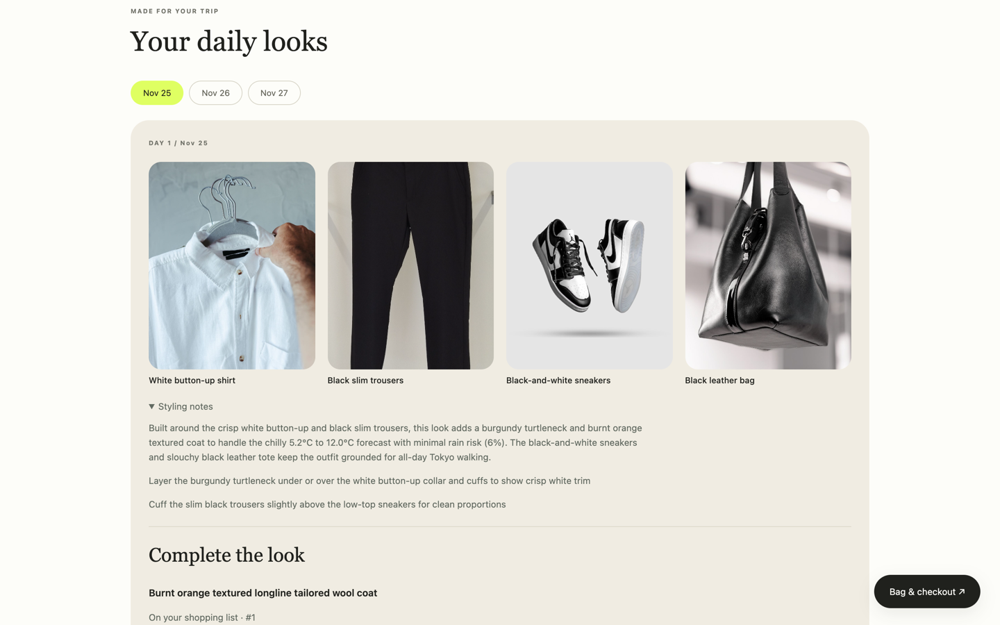
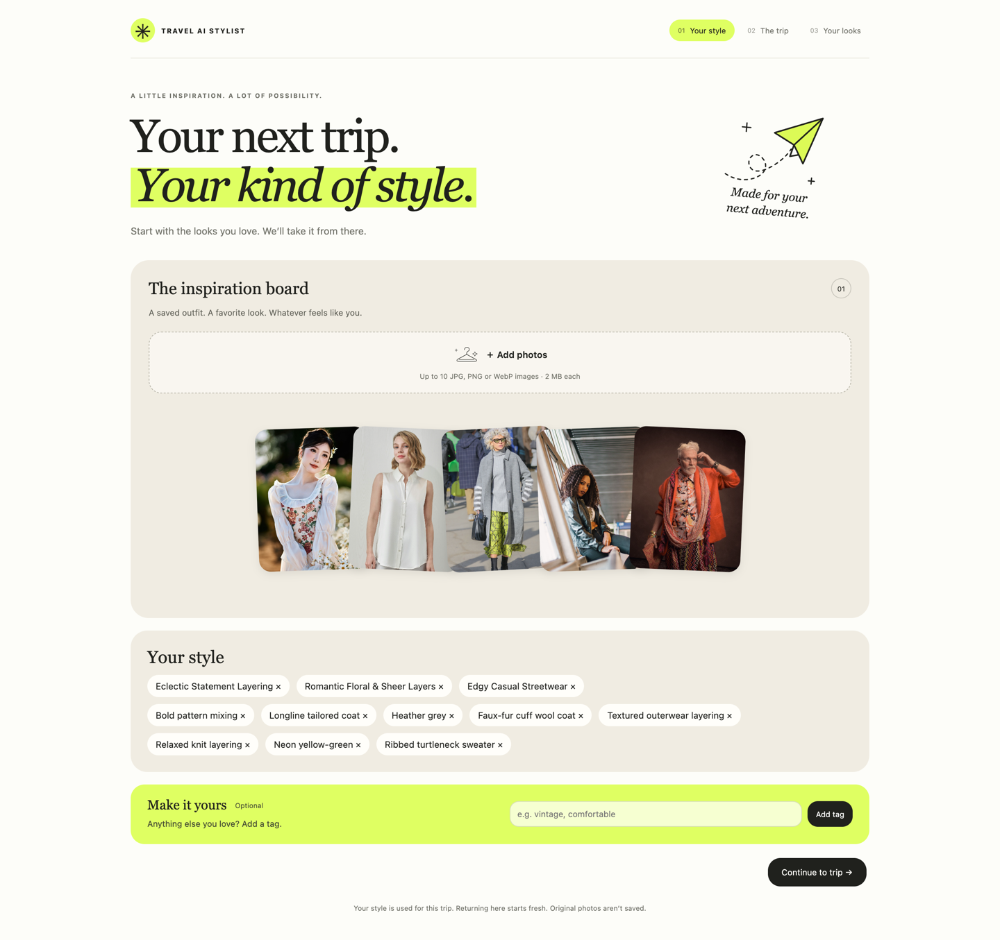
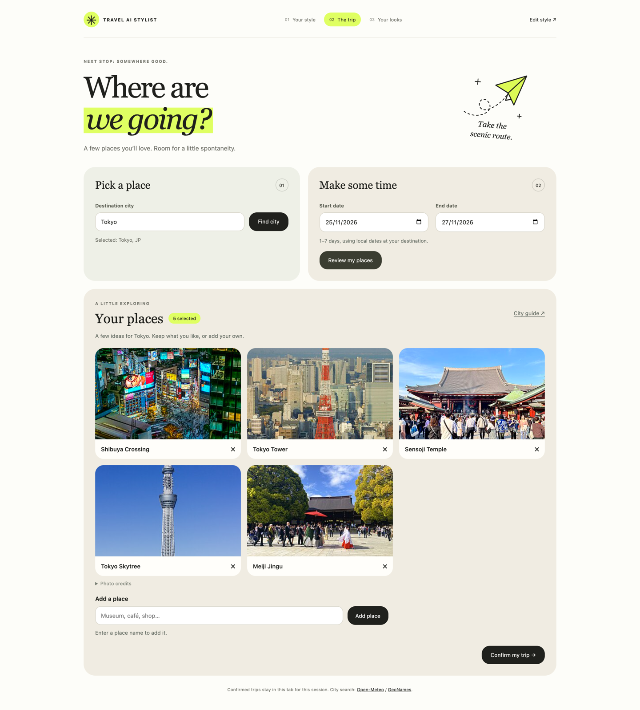
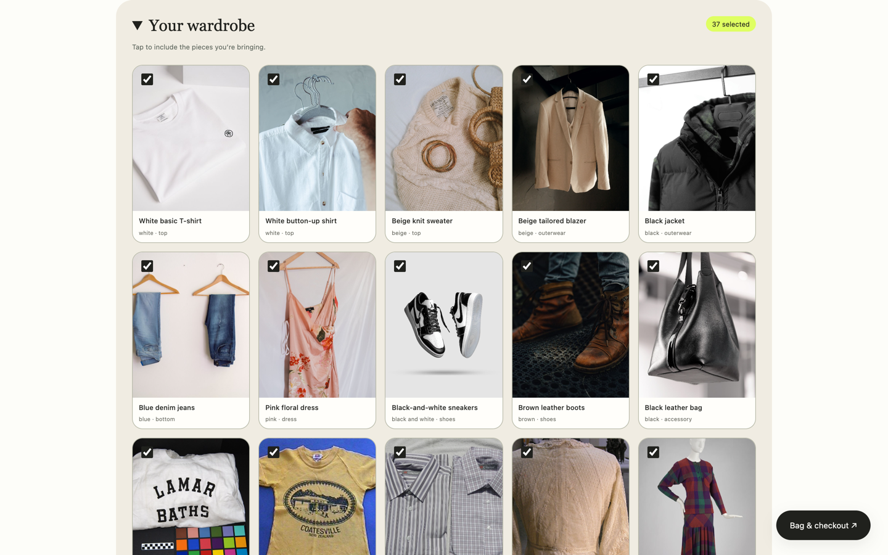
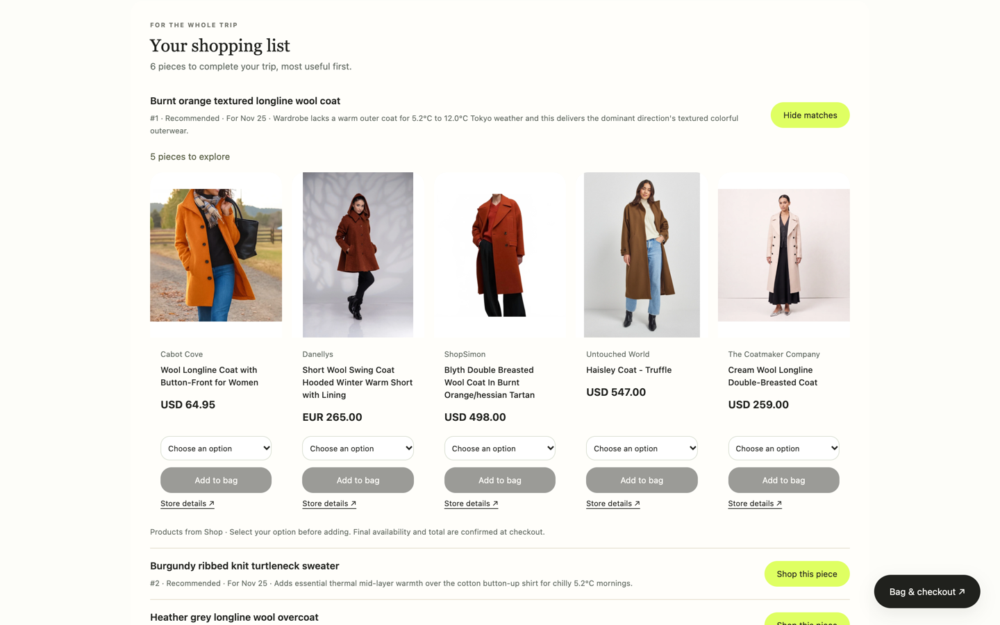
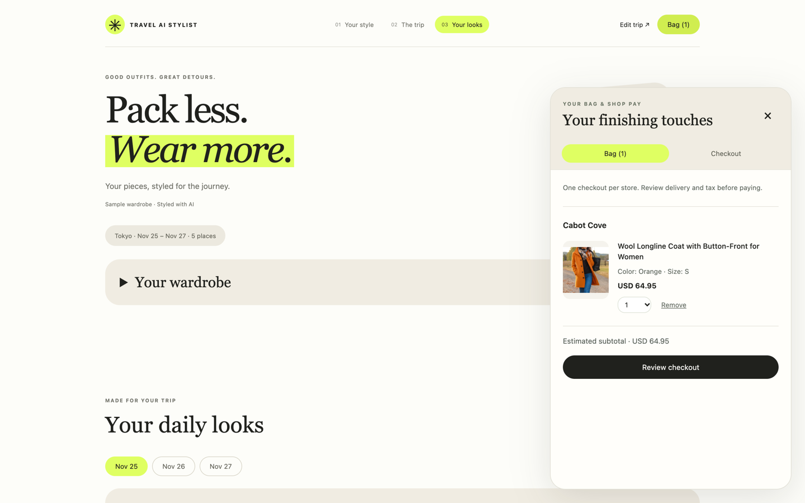

<div align="center">

# ✳ Travel AI Stylist

**Plan the trip. Style the looks. Shop what's missing.**

A multimodal travel-outfit planner built with Gemini 4 for the **Gemini 4 Hackathon — Element 119**.




</div>

---

Packing for a trip usually means guessing. Travel AI Stylist starts with the outfits you already love and learns your style from them. It then looks at where you're going, what you'll do, and the weather forecast, and builds an outfit for each day from your own wardrobe. Anything you're missing becomes a shopping list with real products you can buy.

- 📸 **Learns your style from photos.** Upload up to ten inspiration shots. Gemini picks out your aesthetics, colors, silhouettes and how you layer.
- 🗺️ **Plans around the real trip.** Destination, dates, attractions you choose and the daily weather forecast all shape what you wear.
- 👗 **Styles your own clothes.** Gemini looks at your wardrobe photos and puts together one look per day, with notes on how to wear it.
- 🛍️ **Fills the gaps.** Pieces you don't own become a ranked shopping list, with matching products from Shop and Shop Pay checkout.

## Product tour

### 1 · Show us your style

Drop in a few outfits you love. Gemini reads the photos and returns named style directions such as *Romantic Floral & Sheer Layers* or *Edgy Casual Streetwear*, plus the details behind them. You can remove any tag or add your own; nothing is locked in.



### 2 · Plan the trip

Pick a city and your dates. The app suggests places to visit, which you can keep, remove or add to. The weather forecast is fetched in the background so the outfits match the conditions.



### 3 · Choose what you're packing

Your wardrobe is a set of photos. Untick anything you're leaving at home, and Gemini styles only what's left.



### 4 · Get a look for every day

Each day gets an outfit made from your own pieces. The styling notes explain the choices using the forecast (for example *"5.2°C to 12.0°C with a 6% chance of rain"*) and give practical tips. Anything the look still needs is listed under **Complete the look**.


### 5 · Shop the missing pieces

Missing pieces are combined into one ranked shopping list for the whole trip, and each item explains why it's on the list. **Shop this piece** finds real products. Choose a size or color, add it to your bag, and check out with Shop Pay where the store supports it. Nothing is paid until you confirm it.

<table>
  <tr>
    <td width="50%"></td>
    <td width="50%"></td>
  </tr>
  <tr>
    <td align="center"><sub>Ranked gaps with live product matches</sub></td>
    <td align="center"><sub>Bag and checkout, one per store</sub></td>
  </tr>
</table>

<sub>Screenshots come from a local live run (web app + AI service + Gemini) planning a three-day trip to Tokyo. Inspiration photos are from Unsplash/Pexels. Wardrobe photo credits are in the [fixture manifest](services/ai/tests/fixtures/wardrobe/README.md). The products shown are real Shop search results.</sub>

## How Gemini is used

Our hackathon question: **can Gemini turn messy real-world fashion photos and videos into personal, practical outfit choices?** The model gets the original images, not just metadata about them.

| Step | What Gemini does | Model |
| --- | --- | --- |
| Style analysis | Reads the inspiration photos and returns up to three style directions, each with colors, silhouettes, styling patterns and key pieces | `gemini-4-hydrogen` (web) · `gemini-4-neon` (AI service) |
| Outfit planning | Plans one outfit per day from the style profile, the wardrobe photos, the itinerary and the daily forecast. Also lists missing items and ranked shopping gaps | `gemini-4-hydrogen` |
| Outfit & scene previews | Gemini 4 writes an image brief, then a Gemini image model renders it | `gemini-4-hydrogen` → `gemini-3.1-flash-image` |

Every model can be changed with an environment variable. Benchmarks, prompt versions and experiment results (both what worked and what failed) are in [docs/ai/models.md](docs/ai/models.md) and [docs/ai/experiments/](docs/ai/experiments/).

## Architecture

```text
 Browser (apps/web)                      Node server (apps/web/server.mjs)
 ─────────────────                       ─────────────────────────────────
 Style → Trip → Looks → Bag   ──HTTP──▶  • Photo → style analysis (Gemini)
                                         • City search, places, weather (Open-Meteo)
                                         • Shop product search, cart, Shop Pay
                                         • Proxies outfit planning ─────┐
                                                                         ▼
                                         AI service (services/ai, FastAPI)
                                         • /v1/style-analysis  • /v1/outfit-plans
                                         • /v1/shopping-gaps   • /v1/outfit-previews
```

API keys and service tokens stay on the server and are never sent to the browser. The parts of the system communicate only through the shared contracts in [`packages/contracts/`](packages/contracts/README.md).

## Quick start

You need **Node.js 22.9+**. The web app has no npm dependencies.

```sh
cp .env.example .env        # add GEMINI_API_KEY for photo analysis
npm run dev                 # http://127.0.0.1:3000 (demo mode, mock outfits)
```

| Command | What you get |
| --- | --- |
| `npm run dev` | Full UI with Gemini photo analysis. Outfits come from a labeled local mock |
| `npm run dev:full` | Live mode: the web app and the Python AI service, with Gemini outfit planning from wardrobe photos |
| `npm run dev:shop-test` | A separate, clearly labeled **simulated** shopping and payment flow on port 3002 |
| `npm test` | Integration tests |

For live mode, first set up the AI service's Python environment:

```sh
python3 -m venv services/ai/.venv
services/ai/.venv/bin/python -m pip install -r services/ai/requirements.txt
npm run dev:full
```

> **Note:** live mode needs the nested `StyleProfile` support from PR #5 (`feature/inspiration-weather-directions`), which isn't merged yet. Until it is, `dev:full` stops at startup with a clear error. [Run A + B together](docs/integrations/run-a-and-b.md) explains how to test both in a local worktree.

### Configuration

| Variable | Purpose |
| --- | --- |
| `GEMINI_API_KEY` | Photo style analysis and the AI service (server-side only) |
| `GEMINI_MODEL` / `OUTFIT_MODEL` | Model overrides (default `gemini-4-hydrogen`) |
| `GOOGLE_MAPS_API_KEY` | Optional: Places API (New) for richer place suggestions |
| `AI_BASE_URL` / `AI_SERVICE_TOKEN` | Point the web app at a running AI service. Leave both empty for demo mode |
| `PORT` / `AI_PORT` / `PUBLIC_APP_URL` | Ports and URL for live mode |

See [.env.example](.env.example) for the full list. Never commit `.env`.

## Repository layout

```text
apps/
  web/              Main app: style onboarding, trip planning, daily looks, shopping & checkout
  roamfit-tryon/    Try-On Studio: virtual try-on in destination photos + 360° preview (separate app)
services/
  ai/               Gemini service: style analysis, outfit planning, shopping gaps, previews
packages/
  contracts/        Shared request/response schemas and example payloads
data/
  attractions/      Curated attraction catalog and photos
  demo-wardrobe/    Mock-mode illustrations and the live photo wardrobe mapping
docs/
  ai/               Prompts, model choices, experiments and evaluations
  integrations/     Web ↔ AI API, weather, places, Shop, run guides
  product/          Product scope and UX decisions
  screenshots/      Images used in this README
```

## Try-On Studio

[`apps/roamfit-tryon`](apps/roamfit-tryon/README.md) is a separate app. It puts you, or a stylized *Little Self* avatar, into a real destination photo wearing a chosen outfit, and can optionally turn the figure around for a 360° preview. It has its own setup and isn't connected to the main flow yet.

## Team

| Workstream | Focus |
| --- | --- |
| **A — AI & multimodal** | Style analysis, outfit planning, missing-item descriptors, previews, real-input experiments |
| **B — Product & integrations** | Web app, uploads, destination/weather/places, wardrobe, Shop product search, cart and checkout |
| **C — 3D & try-on** | Avatar viewer, try-on studio, turnaround previews |

## Roadmap

**Shipped:** photo-based style onboarding · editable style profile · trip, places and weather · wardrobe-photo outfit planning · trip-wide shopping list · Shop product search, bag and Shop Pay checkout.

**Next:** generated outfit and destination previews in the main flow · video inspiration · connecting the Try-On Studio · uploading your own closet · restyling an outfit by asking for changes · optimized packing lists.

## Privacy

- Inspiration photos are analyzed and then discarded. They aren't saved to disk, and each visit to the style page starts fresh.
- Gemini and commerce credentials are only used on the server.
- Only use photos you own or have permission to analyze.

## Docs

- [Web app guide](apps/web/README.md)
- [AI service](services/ai/README.md) · [AI workstream](docs/ai/README.md) · [Model choices](docs/ai/models.md)
- [Shared contracts](packages/contracts/README.md) · [Web ↔ AI API](docs/integrations/ai-app-api.md)
- [Run A + B together and test shopping](docs/integrations/run-a-and-b.md)
- [Product scope](docs/product/README.md)
